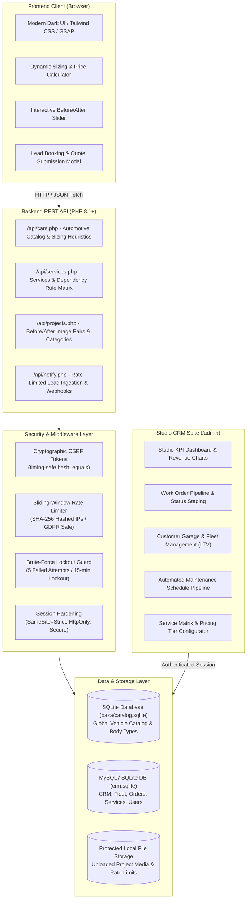

<div align="center">

# Clean N Ride

### Premium Auto Detailing Web Platform & Detailing Studio CRM Suite

[](https://www.php.net/)
[](https://www.mysql.com/)
[](https://www.sqlite.org/)
[](https://developer.mozilla.org/en-US/docs/Web/JavaScript)
[](https://tailwindcss.com/)
[](https://greensock.com/gsap/)
[](admin/login.php)
[](LICENSE)

<br/>

**[🇵🇱 Przejdź do polskiej wersji (Polish README)](README.pl.md)**

<br/><br/>

<div align="center">
  
  <p><em>End-to-End Detailing Studio Flow: Motorsport Hero UI ➔ Real-Time Car Sizing & Quote Estimator ➔ Before/After Comparison Slider ➔ Studio CRM Suite & Fleet Management</em></p>
</div>

</div>

> [!NOTE]
> ### 🛡️ Portfolio Showcase & Architecture Overview
> This repository serves as a **portfolio and architectural showcase** containing high-level system designs, database schemas, interactive visual previews, configuration models, and engineering specifications.
> Full commercial production source code is available to technical recruiters upon request (see below).

---

## 📦 Executive Summary

**Clean N Ride** is an end-to-end commercial web platform and custom back-office CRM engineered specifically for an exclusive automotive detailing studio and motorsport aesthetic garage.

The automotive detailing sector faces two operational bottlenecks:
1. **Customer-Facing Transparency**: Vehicles have vastly different dimensions and paint complexities. Clients typically struggle to estimate costs without manual consultations. Clean N Ride resolves this with a real-time, interactive price estimator integrating an embedded car catalog with an intelligent sizing heuristic engine.
2. **Back-Office Studio Operations**: Detailing workshops struggle to track multi-vehicle customer garages, service warranty schedules, and recurring maintenance intervals (e.g., 6-month ceramic coating top-ups, leather conditioning). Clean N Ride delivers a high-speed back-office CRM with automated lifecycle reminders and customer lifetime value (LTV) analytics.

Built with an uncompromising focus on zero framework bloat, sub-50ms server responses, defensive security, GDPR-compliant privacy, and smooth micro-animations powered by GSAP.

---

## 📸 Real UI Feature Showcase

### 1. 🏎️ Motorsport Aesthetic Hero & Studio Branding
Engineered with a high-contrast dark theme, neon lime accents, and high-performance typography reflecting supercar aesthetic standards. Fully responsive with GSAP ScrollTrigger animations, fast call-to-action buttons, and trust indicators.

<div align="center">
  
  <p><em>Real Homepage: High-contrast branding, dynamic service teasers, and immediate access to the interactive configurator.</em></p>
</div>

<br/>

### 2. 💎 Comprehensive Detailing Services & Package Grid
Categorized presentation of multi-tier detailing packages (Paint Correction, Ceramic Shield 9H, PPF Self-Healing Films, Interior Swissvax Detox). Every card displays base pricing, turnaround labor estimates, and key protective benefits.

<div align="center">
  
  <p><em>Services Showcase: Transparent pricing tiers, warranty periods (up to 5 years), and instant selection into the quote engine.</em></p>
</div>

<br/>

### 3. 🔍 Step 1: Vehicle Search & Heuristic Segment Classification
Clients enter their exact vehicle (Brand, Model, Generation, Body Type). The search connects via debounced REST API to an embedded automotive catalog database. A custom heuristic engine automatically classifies vehicles into sizing tiers (`Segment S`, `Segment M`, `Segment L / SUV`).

<div align="center">
  
  <p><em>Interactive Estimator Step 1: Real-time search with live autocomplete for Porsche 911 (992) Coupe, automatically mapping to Segment S.</em></p>
</div>

<br/>

### 4. ⚡ Step 2: Dynamic Quote Calculator & Dependency Matrix
As clients select services, the calculation engine dynamically recalculates pricing multipliers and estimated workshop labor hours in real time. Features multi-category tabs, dependency rules (e.g. ceramic coating requires paint correction), and an instant order breakdown summary.

<div align="center">
  
  <p><em>Interactive Estimator Step 2: Live quote matrix showing 3500 ZŁ total, ~24.0h estimated labor for Paint Correction Two-Step + Ceramic Coating 9H.</em></p>
</div>

<br/>

### 5. 🪞 Step 3: Interactive Before/After Paint Transformation Slider
Prospective clients can inspect swirl mark removal, paint clarity restoration, and ceramic gloss depth via an interactive Before/After comparison slider with touch and mouse dragging support and category filter pills.

<div align="center">
  
  <p><em>Before/After Slider: Side-by-side inspection of 2-stage paint correction on deep black metallic paint with active interactive divider.</em></p>
</div>

<br/>

### 6. 📊 Detailing Studio CRM Dashboard & Operations Pipeline
Back-office command center providing detailing workshop owners with vital commercial health indicators: monthly revenue KPIs, active pipeline orders (`pending` ➔ `in_progress` ➔ `ready` ➔ `completed`), new customer acquisition, and dynamic turnover charts.

<div align="center">
  
  <p><em>Studio CRM Dashboard: Revenue metrics, active vehicle staging, recent work orders, and quick client navigation.</em></p>
</div>

<br/>

### 7. 🚘 Customer Directory & Multi-Car Fleet Management (LTV)
Comprehensive customer relationship management tracking individual car owners, multi-car fleet garages (e.g., Porsche 911 GT3 RS, BMW M3 CS), cumulative Customer Lifetime Value (LTV), service notes, and appointment histories.

<div align="center">
  
  <p><em>Fleet Management: Client profiles with vehicle registration numbers, VIN codes, total spend badges (14 450 zł LTV), and maintenance history.</em></p>
</div>

---

## 🏗️ System Architecture



---

## 🧠 Engineering Highlights & Defensive Security

### 1. Sizing Heuristic Engine (`api/cars.php`)
Vehicle databases often suffer from administrative misclassifications (e.g., large executive SUVs classified under general wagons or compact crossovers misidentified). Clean N Ride employs a custom regex heuristic engine that normalizes vehicle model strings before falling back to official catalog body types:

```php
function getModelBaseSegment(string $brand, string $model): ?int {
    $full = strtolower(trim($brand . ' ' . $model));

    // Force Large / SUV segment for executive SUVs & trucks
    if (preg_match('/\b(x5|x6|x7|q7|q8|gle|gls|cayenne|range rover|touareg|f-150|ram|urus|dbx)\b/i', $full)) {
        return 2; // Segment L (SUV / Van / Luxury)
    }
    // Force Small segment for compact city vehicles
    if (preg_match('/\b(fiat 500|yaris|corsa|clio|i10|i20|up!|aygo|smart|mini)\b/i', $full)) {
        return 0; // Segment S (Small / Compact)
    }
    return null; // Fallback to database body-type mapping (Sedan/Touring -> Segment M)
}
```

### 2. GDPR-Compliant Privacy Rate Limiting (`api/notify.php`)
To prevent denial-of-service and contact form spam without violating strict GDPR privacy statutes regarding raw IP storage, Clean N Ride hashes remote IP addresses with SHA-256 before disk persistence:

```php
// Privacy-preserving rate limiter (Zero raw IP storage on disk)
$clientIp      = $_SERVER['REMOTE_ADDR'] ?? '0.0.0.0';
$hashedIp      = hash('sha256', $clientIp);
$rateLimitFile = $rateLimitDir . $hashedIp . '.json';

$now = time();
$history = file_exists($rateLimitFile) ? json_decode(file_get_contents($rateLimitFile), true) : [];
$history = array_filter($history, fn($ts) => ($now - $ts) < 300); // 5-minute sliding window

if (count($history) >= 5) {
    http_response_code(429);
    echo json_encode(['error' => 'Rate limit exceeded. Please wait a few minutes.']);
    exit;
}
```

### 3. Service Dependency & Exclusions Matrix
The pricing calculator implements deterministic business constraints configured directly in the database:
- `rules_requires`: Services requiring prerequisites (e.g., *Ceramic Coating 9H* requires at least *1-Stage Paint Correction*).
- `rules_excludes`: Mutually exclusive options (e.g., *1-Stage Correction* vs. *2-Stage Correction*).
- `rules_requires_or`: Flexible prerequisites supporting either option A or option B.

### 4. Automated Post-Service Maintenance Pipeline
Detailing longevity depends on scheduled maintenance. The CRM automatically calculates recurring warranty inspection dates upon marking a work order as `completed`:
- **6-Month & 12-Month**: Ceramic Coating Hydrophobic Review & Decontamination
- **3-Month & 4-Month**: Polymer Wax Refresh
- **6-Month**: Deep Leather Conditioning & Swissvax Treatment
- **6-Month**: Hydrophobic Glass Shield Re-application
- **12-Month**: Full Interior Antimicrobial Detox

---

## 🗄️ Database Architecture

The platform utilizes a dual-engine architecture:
1. **Automotive Catalog (`baza/catalog.sqlite`)**: High-speed, read-only embedded SQLite database (~386 KB) with thousands of global makes, models, generations, and body configurations.
2. **Studio CRM & Web Database (`MySQL` with SQLite fallback `baza/crm.sqlite`)**:
   - `services`: Detailing catalog, pricing for segments S/M/L, labor hours, and dependency rules.
   - `categories`: Service classification taxonomy.
   - `customers`: Client profiles, contact channels, notes, and aggregate spend metrics.
   - `customer_cars`: Multi-vehicle garage registry (license plate, VIN, year, color, segment).
   - `orders`: Work order lifecycle, assigned vehicles, pricing snapshots, and progress status.
   - `projects`: Before/After transformation showcase with categorized image pairs.
   - `users`: Authenticated studio personnel with bcrypt passwords and permission levels.

---

## 🚀 Quick Start & Local Setup

### System Prerequisites
- **PHP 8.1** or higher (with `pdo_sqlite` and `pdo_mysql` extensions enabled)
- **Web Server** (Built-in PHP server, Apache, or Nginx)
- **MySQL 8.0+** (optional; SQLite fallback runs standalone out of the box)

### 1. Clone the Showcase Repository
```bash
git clone https://github.com/verblo/clean-n-ride-showcase.git
cd clean-n-ride-showcase
```

### 2. Configure Environment (Optional)
The platform includes an example configuration file:
```bash
cp config.example.php config.local.php
```

If connecting to MySQL, update your credentials:
```php
define('DB_HOST',    'localhost');
define('DB_NAME',    'cleannride_crm');
define('DB_USER',    'root');
define('DB_PASS',    'your_secure_password');
define('DB_CHARSET', 'utf8mb4');
```
*Note: If MySQL is not configured, the platform automatically switches to the self-contained SQLite database (`baza/crm.sqlite`).*

### 3. Run Development Server
```bash
php -d extension=pdo_sqlite -d extension=sqlite3 -S 127.0.0.1:8000
```

### 4. Access the Application
- **Customer Web Platform & Calculator**: Open [http://127.0.0.1:8000](http://127.0.0.1:8000)
- **Studio CRM & Admin Portal**: Open [http://127.0.0.1:8000/admin](http://127.0.0.1:8000/admin)
  - **Username**: `admin`
  - **Password**: `admin123`

---

## 📄 License

This repository is licensed under the [MIT License](LICENSE).

---

## 💥 Informacja dla Rekruterów / Recruiter Notice

> **Pełny kod źródłowy projekt dostępny do wglądu dla rekruterów na życzenie po kontakcie mailowym.**
> 
> The complete production source code, commit history, and technical documentation are available for recruiters and hiring managers upon request:
> - 📬 **E-mail**: [dominikzatorski8@gmail.com](mailto:dominikzatorski8@gmail.com)
> - 💼 **LinkedIn**: [Dominik Zatorski](https://pl.linkedin.com/in/dominik-zatorski-b1a82a1b9)
> - 🐙 **GitHub Profile**: [@verblo](https://github.com/verblo)

---

## 👤 Author

**Dominik Zatorski**
- Portfolio / GitHub: [@verblo](https://github.com/verblo)
- LinkedIn: [Dominik Zatorski](https://pl.linkedin.com/in/dominik-zatorski-b1a82a1b9)
- Email: [dominikzatorski8@gmail.com](mailto:dominikzatorski8@gmail.com)
