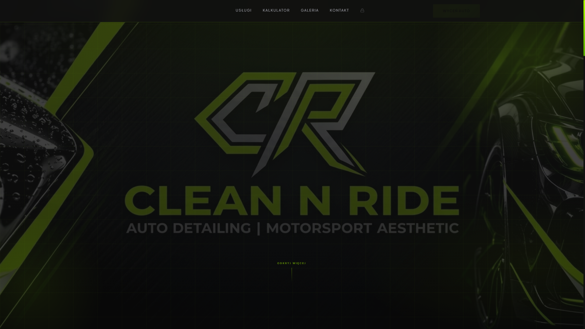
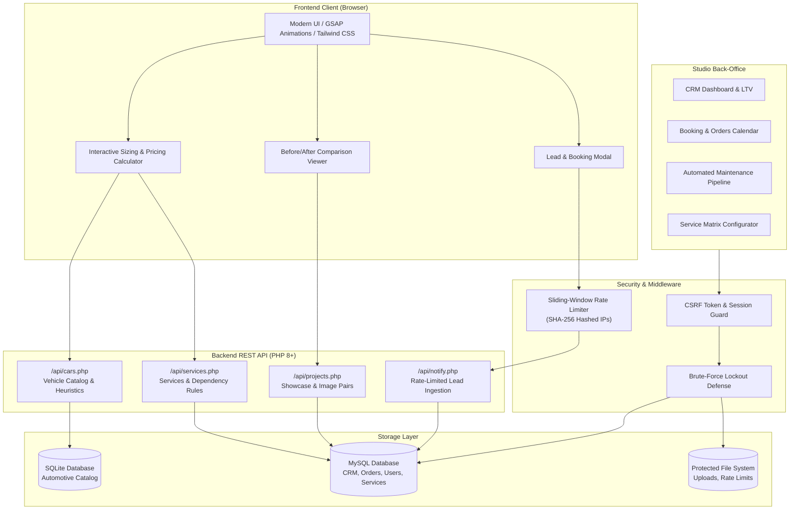

<div align="center">

# Clean N Ride

### Full-Stack Auto Detailing Web Platform & Studio CRM Suite

[](https://www.php.net/)
[](https://www.mysql.com/)
[](https://www.sqlite.org/)
[](https://developer.mozilla.org/en-US/docs/Web/JavaScript)
[](https://tailwindcss.com/)
[](LICENSE)
[](admin/login.php)

<br/>

**[🇵🇱 Przejdź do polskiej wersji (Polish README)](README.pl.md)**

<br/>

> [!NOTE]
> ### 🏛️ System Showcase & Architecture Overview
> This repository serves as a **portfolio and architectural showcase** containing high-level system designs, database schemas, interactive visual previews, configuration models, and engineering specifications.
> Full commercial production source code is available to technical recruiters upon request (see below).

<div align="center">
  
  <p><em>Clean N Ride: Automotive Detailing Studio Web Platform & Interactive Quote Estimator</em></p>
</div>

</div>

---

## 📌 Executive Summary

**Clean N Ride** is an end-to-end commercial web platform and custom CRM developed for an exclusive automotive detailing and motorsport aesthetic studio. 

The project addresses two critical challenges in the car detailing industry:
1. **Customer-Facing Transparency**: Providing car owners with an instant, interactive dynamic quote calculator that automatically adjusts pricing based on the exact vehicle size segment, coupled with an interactive before/after transformation showcase.
2. **Business Automation & Studio Operations**: Delivering a lightweight, high-performance back-office CRM to manage customer lifecycle, multi-car fleets, appointments, work orders, and automated maintenance reminder cycles (ceramic reviews, wax refreshes, leather care).

Built with a focus on speed, defensive security, zero framework bloat, and smooth UX animations (GSAP).

---

## 🚀 Key Features

### 1. 🧮 Interactive Dynamic Price Calculator
- **Automotive Database Integration**: Connects to an embedded SQLite catalog with thousands of car brands, models, generations, and factory body types.
- **Intelligent Vehicle Sizing Engine**: Implements a custom heuristic classifier (`getModelBaseSegment`) that normalizes official vehicle data and categorizes vehicles into accurate detailing sizing classes (Small, Medium, Large / SUV).
- **Rule Engine & Dependency Resolution**: Supports conditional logic between services, including mutually exclusive services (`rules_excludes`), strict requirements (`rules_requires`), and optional dependencies (`rules_requires_or` with `AND`/`OR` modes).
- **Live Estimation**: Calculates total price and labor hours in real-time as users toggle packages, paint correction stages, ceramic coatings, or interior detailing.

### 2. 📸 Before / After Transformation Showcase
- Interactive side-by-side comparison slider allowing clients to inspect paint correction, swirl removal, and coating depth.
- Dynamic project management with image upload and sort-order handling.

### 3. 🛡️ Enterprise-Grade Security Architecture
- **CSRF Defense**: Cryptographically secure token generation (`bin2hex(random_bytes(32))`) validated on every state-changing POST request with timing-safe checks.
- **Session Hardening**: Configured with `SameSite=Strict`, `HttpOnly`, and `Secure` cookie flags, paired with session ID regeneration upon authentication to eliminate session fixation.
- **GDPR-Compliant Rate Limiting & Lockout**:
  - Lead submission rate-limiting (sliding window).
  - Admin brute-force protection (lockout after 5 consecutive failed attempts).
  - **Zero plaintext IPs on disk**: IP addresses are SHA-256 hashed before writing to storage, guaranteeing user privacy compliance.
- **Strict Input Sanitization & Bounds**: Whitelisted regex, phone/email validation, and numeric sanity checks across all API endpoints.
- **SQL Injection Prevention**: 100% prepared PDO statements with emulation disabled (`PDO::ATTR_EMULATE_PREPARES => false`).
- **Server-Level Protection**: Apache `.htaccess` rules denying direct HTTP access to configuration files, SQLite databases, logs, and sensitive directories.

### 4. 📊 Detailing Studio CRM & Admin Suite
- **Customer Relationship Management**: Complete profile management with Customer Lifetime Value (LTV) calculation and multi-vehicle garage management.
- **Order Pipeline**: State tracking for detailing work (`pending` ➔ `in_progress` ➔ `ready` ➔ `completed`).
- **Studio Calendar**: Appointment scheduling and capacity tracking.
- **Automated Service Reminders**: Automated post-service maintenance schedule generation:
  - 6-month & 12-month Ceramic Coating Reviews
  - 3-month & 4-month Wax Refreshes
  - 6-month Leather Conditioning
  - 6-month Hydrophobic Glass Coating Refresh
  - 12-month Interior Detox
- **Service Matrix Configurator**: Visual editor to configure detailing services, pricing tiers per car segment, estimated labor hours, and rule constraints.

---

## 🏛️ System Architecture



---

## 🗄️ Database Design

The relational database architecture consists of 12 normalized tables:

| Table | Purpose | Key Relationships |
|:---|:---|:---|
| `users` | Admin credentials & password hashes (`bcrypt`) | Authentication |
| `sys_config` | System settings and schema migration versioning | Global config |
| `customers` | Client profiles, contact details, total LTV | 1:N with cars, orders, appointments |
| `customer_cars` | Multi-car garage per client (brand, model, VIN, plate) | Foreign Key ➔ `customers.id` |
| `orders` | Detailing orders, service list, price, status | Foreign Key ➔ `customers.id` |
| `appointments` | Scheduled studio visits and calendar slots | Foreign Key ➔ `customers.id` |
| `service_reminders`| Automated maintenance tasks (ceramic/wax/leather) | Foreign Key ➔ `customers.id` |
| `notifications` | Web lead submissions and pending quotes | Lead ingestion |
| `calc_categories` | Service categories for the calculator | 1:N with `calc_services` |
| `calc_services` | Services, multi-segment pricing, dependency rules | Configured by studio admin |
| `projects` | Portfolio projects and detailing showcases | 1:N with `project_pairs` |
| `project_pairs` | Before/After image comparisons with sort ordering | Foreign Key ➔ `projects.id` |

---

## 💻 Tech Stack

- **Frontend**: HTML5, Vanilla JavaScript (ES6+), Tailwind CSS, GSAP 3 (GreenSock Animation Platform), ScrollTrigger, Cinzel & Plus Jakarta Sans typography.
- **Backend**: Native PHP 8.1+ (Object-Oriented PDO, zero heavy third-party framework overhead).
- **Databases**: 
  - **MySQL 8.0+ / MariaDB**: Core transactional CRM database with foreign keys and migrations.
  - **SQLite 3**: Embedded fast read-only automotive vehicle catalog (~8 MB).
- **Security**: SHA-256 IP tokenization, CSRF token exchange, password hashing with bcrypt, Apache HTTP access control.

---

## 📂 Project Directory Structure

```text
Clean-N-Ride/
├── admin/                     # Studio Back-Office & CRM
│   ├── db.php                 # Central PDO database bootstrap
│   ├── index.php              # CRM Dashboard, Orders, Calendar, Reminders
│   ├── login.php              # Hardened authentication & lockout protection
│   └── logout.php             # Safe session termination
├── api/                       # Public REST API Endpoints
│   ├── cars.php               # Automotive catalog & segment heuristic engine
│   ├── notify.php             # Rate-limited lead submission
│   ├── projects.php           # Portfolio & transformation gallery data
│   └── services.php           # Service categories, pricing & rules matrix
├── baza/                      # Database Assets & Schemas
│   ├── .htaccess              # Direct HTTP access block
│   ├── catalog.sqlite         # Embedded vehicle database
│   └── schema.sql             # Full MySQL schema & seed data
├── data/                      # Protected Runtime Data
│   ├── .htaccess              # Deny from all
│   ├── login_attempts/        # Brute-force lockout cache (.gitkeep)
│   └── rate_limits/           # API request throttling cache (.gitkeep)
├── js/                        # Frontend Utilities
│   └── car-utils.js           # Vehicle string normalization & formatting
├── uploads/                   # Media Storage
│   └── gallery/               # Portfolio uploaded images (.gitkeep)
├── .gitattributes             # Line ending normalization (LF)
├── .gitignore                 # Secrets & runtime artifact exclusions
├── .htaccess                  # Apache server configuration & hardening
├── Baner.jpeg                 # Hero background visual asset
├── Logo.png                   # Official studio brand identity
├── config.example.php         # Safe configuration template
├── index.html                 # Main studio web platform & calculator
├── LICENSE                    # MIT License
├── README.md                  # Project documentation (English)
└── README.pl.md               # Project documentation (Polish)
```

---

## ⚡ Quick Start & Local Setup

### Prerequisites
- **PHP 8.1** or higher (with `pdo_mysql` and `pdo_sqlite` extensions enabled)
- **MySQL 5.7+ / MariaDB 10.3+**

### 1. Clone the Repository
```bash
git clone https://github.com/verblo/clean-n-ride.git
cd clean-n-ride
```

### 2. Configure Database
Copy the example configuration file:
```bash
cp config.example.php config.local.php
```

Open `config.local.php` in your editor and enter your local database credentials:
```php
define('DB_HOST',    'localhost');
define('DB_NAME',    'cleannride_crm');
define('DB_USER',    'root');
define('DB_PASS',    'your_password');
define('DB_CHARSET', 'utf8mb4');
```

### 3. Import MySQL Schema
Create your database and import the ready-to-use schema:
```bash
mysql -u root -p -e "CREATE DATABASE cleannride_crm CHARACTER SET utf8mb4 COLLATE utf8mb4_unicode_ci;"
mysql -u root -p cleannride_crm < baza/schema.sql
```

### 4. Run the Development Server
Using PHP's built-in web server:
```bash
php -S localhost:8000
```

### 5. Access the Platform
- **Public Website & Calculator**: Open [http://localhost:8000](http://localhost:8000)
- **Studio CRM & Admin Suite**: Open [http://localhost:8000/admin](http://localhost:8000/admin)
  - **Default Login**: `admin`
  - **Default Password**: `admin123` *(Be sure to change in production!)*

---

## 🔍 Engineering Highlights & Key Code Patterns

### Sizing Heuristic Engine (`api/cars.php`)
Standard vehicle databases frequently contain clerical misclassifications (e.g., classifying a high-performance estate as a hatchback or misidentifying compact SUVs). The custom sizing heuristic engine normalizes full model strings and enforces accurate detailing tiers:

```php
function getModelBaseSegment(string $brand, string $model): ?int {
    $full = strtolower(trim($brand . ' ' . $model));

    // Force Large / SUV segment for large executive SUVs
    if (preg_match('/\b(x5|x6|x7|q7|q8|gle|gls|cayenne|range rover|touareg)\b/i', $full)) {
        return 2; // Segment L
    }
    // Force Small segment for compact city cars
    if (preg_match('/\b(fiat 500|yaris|corsa|clio|i10|i20|up!|aygo)\b/i', $full)) {
        return 0; // Segment S
    }
    return null; // Fallback to database body-type mapping
}
```

### Privacy-Preserving Rate Limiter (`api/notify.php`)
To ensure complete GDPR compliance while mitigating spam and automated denial-of-service attempts, IP addresses are hashed using SHA-256 before disk persistence:

```php
$clientIp      = $_SERVER['REMOTE_ADDR'] ?? '0.0.0.0';
$rateLimitFile = $rateLimitDir . hash('sha256', $clientIp) . '.json';
```

---

## 📄 License

This project is licensed under the [MIT License](LICENSE) - feel free to use it for personal or commercial projects.

---

---

## 💼 Informacja dla Rekruterów / Recruiter Notice

> **Pełny kod źródłowy projekt dostępny do wglądu dla rekruterów na życzenie po kontakcie mailowym.**
> 
> The complete production source code, commit history, and technical documentation are available for recruiters and hiring managers upon request:
> - 📬 **E-mail**: [dominikzatorski8@gmail.com](mailto:dominikzatorski8@gmail.com)
> - 💼 **LinkedIn**: [Dominik Zatorski](https://pl.linkedin.com/in/dominik-zatorski-b1a82a1b9)
> - 🐙 **GitHub Profile**: [@verblo](https://github.com/verblo)

---

## 👤 Author

**Dominik Zatorski**
- Portfolio / GitHub: [@verblo](https://github.com/verblo)
- LinkedIn: [Dominik Zatorski](https://pl.linkedin.com/in/dominik-zatorski-b1a82a1b9)
