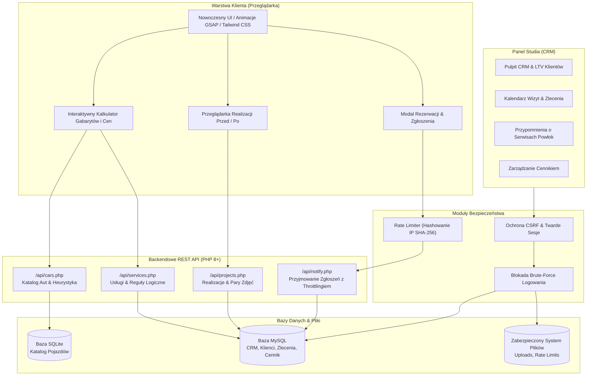

<div align="center">

# Clean N Ride

### Platforma Webowa dla Studia Auto Detailingu & Dedykowany System CRM

[](https://www.php.net/)
[](https://www.mysql.com/)
[](https://www.sqlite.org/)
[](https://developer.mozilla.org/en-US/docs/Web/JavaScript)
[](https://tailwindcss.com/)
[](LICENSE)
[](admin/login.php)

<br/>

**[🇬🇧 Switch to English Version (README.md)](README.md)**

</div>

---

## 📌 O Projekcie

**Clean N Ride** to komercyjna, pełnozakresowa (full-stack) platforma internetowa wraz z dedykowanym systemem CRM, zaprojektowana dla studia auto detailingu klasy premium oraz motorsport aesthetic.

Projekt rozwiązuje dwa kluczowe wyzwania biznesowe branży car detailingu:
1. **Dla klienta**: Umożliwia precyzyjną i natychmiastową wycenę usług w oparciu o dokładny segment gabarytowy wybranego pojazdu oraz prezentuje efekty prac w interaktywnym porównywarce Przed / Po (Before/After).
2. **Dla studia**: Oferuje lekki, ultraszybki system CRM do zarządzania klientami, flotą aut, harmonogramem wizyt, zleceniami oraz zautomatyzowanym potokiem powiadomień serwisowych (np. przeglądy powłok ceramicznych, odświeżanie wosków, pielęgnacja skór).

Aplikacja została zbudowana z naciskiem na maksymalną wydajność, defensywne bezpieczeństwo, brak zbędnego narzutu ciężkich frameworków oraz płynne mikro-animacje (GSAP).

---

## 🚀 Kluczowe Funkcjonalności

### 1. 🧮 Inteligentny Kalkulator Wyceny On-line
- **Baza Pojazdów**: Wbudowana baza SQLite zawierająca tysiące marek, modeli, generacji i fabrycznych typów nadwozia.
- **Silnik Heurystyczny Segmentacji (`getModelBaseSegment`)**: Algorytm normalizujący dane urzędowe/katalogowe i przypisujący pojazdy do właściwych klas gabarytowych studia (S – Małe, M – Średnie, L – Duże / SUV).
- **Złożone Reguły Zależności Usług**: Obsługa wykluczeń (`rules_excludes`), wymogów bezwzględnych (`rules_requires`) oraz alternatywnych zależności (`rules_requires_or` z trybami `AND`/`OR`).
- **Wycena w Czasie Rzeczywistym**: Natychmiastowe przeliczanie ceny końcowej i szacowanego czasu realizacji przy wyborze pakietów, etapów korekty lakieru, powłok ceramicznych czy detailingu wnętrza.

### 2. 📸 Interaktywny Slider Przed / Po (Before & After)
- Interaktywny suwak umożliwiający płynne porównanie stanu lakieru przed i po korekcie (obsługa myszy i ekranów dotykowych).
- Panel administracyjny pozwalający na dodawanie realizacji, wgrywanie zdjęć oraz sortowanie par porównawczych.

### 3. 🛡️ Architektura Bezpieczeństwa (Security-First)
- **Ochrona przed CSRF**: Krypto-bezpieczne tokeny (`bin2hex(random_bytes(32))`) weryfikowane przy każdym żądaniu typu POST metodą odporną na ataki czasowe.
- **Utwardzone Sesje**: Flagi ciasteczek `SameSite=Strict`, `HttpOnly` oraz `Secure`. Regeneracja identyfikatora sesji (`session_regenerate_id(true)`) po zalogowaniu, eliminująca ryzyko Session Fixation.
- **Ochrona przed Brute-Force & Rate Limiting (zgodne z RODO/GDPR)**:
  - Ograniczenie liczby zapytań dla formularza kontaktowego (algorytm ruchomego okna – sliding window).
  - Blokada logowania po 5 nieudanych próbach na 15 minut.
  - **Brak jawnych adresów IP na dysku**: Identyfikatory IP są haszowane algorytmem SHA-256 przed zapisem, co gwarantuje pełną prywatność i zgodność z RODO.
- **Walidacja Danych**: Rygorystyczna weryfikacja formatu danych, numerów telefonów, adresów e-mail oraz ograniczenia długości stringów.
- **Bezpieczeństwo SQL**: Wyłączenie emulacji prepared statements (`PDO::ATTR_EMULATE_PREPARES => false`) i 100% zapytań parametryzowanych (ochrona przed SQL Injection).
- **Konfiguracja Serwera**: Reguły `.htaccess` blokujące bezpośredni dostęp HTTP do plików konfiguracyjnych, baz danych SQLite, logów i katalogów systemowych.

### 4. 📊 Studio CRM & Panel Administracyjny
- **Karty Klientów & Wskaźnik LTV**: Pełna historia klienta, baza kontaktowa oraz automatyczne zliczanie całkowitej wartości klienta (Life-Time Value).
- **Garaż Klienta**: Możliwość przypisania wielu pojazdów (marka, model, rocznik, nr rejestracyjny, VIN) do jednego klienta.
- **Harmonogram & Zlecenia**: Statusy realizacji (`pending` ➔ `in_progress` ➔ `ready` ➔ `completed`) oraz kalendarz wizyt.
- **Automatyczny System Przypomnień Serwisowych**:
  - Przegląd powłoki ceramicznej po 6 i 12 miesiącach,
  - Odświeżenie wosku po 3 i 4 miesiącach,
  - Konserwacja tapicerki skórzanej po 6 miesiącach,
  - Odświeżenie niewidzialnej wycieraczki po 6 miesiącach,
  - Kompleksowy detox wnętrza po 12 miesiącach.
- **Konfigurator Cennika i Usług**: Panel do edycji cennika dla segmentów S/M/L, szacowanego czasu pracy oraz powiązań między usługami.

---

## 🏛️ Architektura Systemu



---

## 🗄️ Model Bazy Danych

Relacyjna struktura danych opiera się na 12 znormalizowanych tabelach:

| Tabela | Przeznaczenie | Kluczowe Relacje |
|:---|:---|:---|
| `users` | Dane kont administratorów i hashe haseł (`bcrypt`) | Uwierzytelnianie |
| `sys_config` | Konfiguracja systemowa oraz wersjonowanie migracji | Globalna konfiguracja |
| `customers` | Profile klientów, dane kontaktowe, wskaźnik LTV | 1:N z autami, zleceniami, wizytami |
| `customer_cars` | Garaż pojazdów przypisanych do klienta | Klucz obcy ➔ `customers.id` |
| `orders` | Zlecenia detailingu, wybrane usługi, ceny, statusy | Klucz obcy ➔ `customers.id` |
| `appointments` | Zaplanowane wizyty w kalendarzu studia | Klucz obcy ➔ `customers.id` |
| `service_reminders`| Zadania cyklicznych przeglądów (ceramika/wosk/skóra) | Klucz obcy ➔ `customers.id` |
| `notifications` | Zgłoszenia ze strony i oczekujące wyceny | Ingestion leadów |
| `calc_categories` | Kategorie usług w kalkulatorze | 1:N z `calc_services` |
| `calc_services` | Usługi, cennik trójsegmentowy, reguły zależności | Zarządzane z poziomu CRM |
| `projects` | Wpisy w galerii realizacji | 1:N z `project_pairs` |
| `project_pairs` | Pary zdjęć Przed / Po z kolejnością wyświetlania | Klucz obcy ➔ `projects.id` |

---

## 💻 Wykorzystane Technologie

- **Frontend**: HTML5, Vanilla JavaScript (ES6+), Tailwind CSS, GSAP 3 (GreenSock Animation Platform), ScrollTrigger, typografia Cinzel & Plus Jakarta Sans.
- **Backend**: Czysty PHP 8.1+ (Obiektowe PDO, bez narzutu ciężkich frameworków).
- **Bazy Danych**: 
  - **MySQL 8.0+ / MariaDB**: Główna baza transakcyjna CRM (klucze obce, relacje kaskadowe, indeksy).
  - **SQLite 3**: Wbudowana, ultraszybka baza katalogu pojazdów (~8 MB).
- **Bezpieczeństwo**: Tokenizacja IP z SHA-256, ochrona CSRF, haszowanie haseł bcrypt, reguły dostępu Apache `.htaccess`.

---

## 📂 Struktura Katalogów Projektu

```text
Clean-N-Ride/
├── admin/                     # Zaplecze CRM i Panel Studia
│   ├── db.php                 # Centralne połączenie PDO MySQL
│   ├── index.php              # Główny panel CRM, Zlecenia, Kalendarz, Przypomnienia
│   ├── login.php              # Bezpieczne logowanie z blokadą ataków brute-force
│   └── logout.php             # Bezpieczne niszczenie sesji
├── api/                       # Publiczne Punkty Końcowe (REST API)
│   ├── cars.php               # Baza modeli aut & heurystyka segmentów
│   ├── notify.php             # Obsługa formularza rezerwacji z rate-limitem
│   ├── projects.php           # Realizacje i zdjęcia przed/po
│   └── services.php           # Kategorie, cennik i reguły kalkulatora
├── baza/                      # Bazy Danych i Schematy
│   ├── .htaccess              # Blokada bezpośredniego pobierania baz przez HTTP
│   ├── catalog.sqlite         # Wbudowany katalog modeli aut
│   └── schema.sql             # Kompletny schemat bazy MySQL z danymi startowymi
├── data/                      # Chronione Dane Wykonawcze
│   ├── .htaccess              # Blokada dostępu (Deny from all)
│   ├── login_attempts/        # Pamięć blokad logowania (.gitkeep)
│   └── rate_limits/           # Pamięć throttlingu zapytań (.gitkeep)
├── js/                        # Narzędzia Frontendowe
│   └── car-utils.js           # Normalizacja nazw marek i modeli
├── uploads/                   # Magazyn Multimediów
│   └── gallery/               # Wgrane zdjęcia realizacji (.gitkeep)
├── .gitattributes             # Standaryzacja końców linii (LF)
├── .gitignore                 # Wykluczenia plików wrażliwych i cache
├── .htaccess                  # Konfiguracja i utwardzenie serwera Apache
├── Baner.jpeg                 # Tło sekcji Hero
├── Logo.png                   # Identyfikacja wizualna studia
├── config.example.php         # Bezpieczny szablon konfiguracji bazy
├── index.html                 # Strona główna z kalkulatorem i portfolio
├── LICENSE                    # Licencja MIT
├── README.md                  # Dokumentacja projektu (angielska)
└── README.pl.md               # Dokumentacja projektu (polska)
```

---

## ⚡ Szybki Start & Uruchomienie Lokalne

### Wymagania wstępne
- **PHP 8.1** lub nowszy (z rozszerzeniami `pdo_mysql` oraz `pdo_sqlite`)
- **MySQL 5.7+ / MariaDB 10.3+**

### 1. Klonowanie repozytorium
```bash
git clone https://github.com/verblo/clean-n-ride.git
cd clean-n-ride
```

### 2. Konfiguracja połączenia z bazą
Skopiuj plik szablonu konfiguracji:
```bash
cp config.example.php config.local.php
```

Otwórz plik `config.local.php` i wpisz dane dostępowe do lokalnej bazy MySQL:
```php
define('DB_HOST',    'localhost');
define('DB_NAME',    'cleannride_crm');
define('DB_USER',    'root');
define('DB_PASS',    'twoje_haslo');
define('DB_CHARSET', 'utf8mb4');
```

### 3. Zaimportowanie bazy danych MySQL
Utwórz bazę danych i wgraj przygotowany schemat ze startowymi danymi:
```bash
mysql -u root -p -e "CREATE DATABASE cleannride_crm CHARACTER SET utf8mb4 COLLATE utf8mb4_unicode_ci;"
mysql -u root -p cleannride_crm < baza/schema.sql
```

### 4. Uruchomienie wbudowanego serwera PHP
W głównym katalogu projektu uruchom:
```bash
php -S localhost:8000
```

### 5. Dostęp do aplikacji
- **Strona Główna & Kalkulator**: [http://localhost:8000](http://localhost:8000)
- **Panel CRM Administracji**: [http://localhost:8000/admin](http://localhost:8000/admin)
  - **Domyślny login**: `admin`
  - **Domyślne hasło**: `admin123` *(Pamiętaj o zmianie na produkcji!)*

---

## 📄 Licencja

Projekt udostępniany jest na warunkach otwartoźródłowej licencji [MIT](LICENSE).

---

---

## 💼 Informacja dla Rekruterów

> **Pełny kod źródłowy projekt dostępny do wglądu dla rekruterów na życzenie po kontakcie mailowym.**
> 
> Pełna wersja kodu produkcyjnego, historia commitów oraz dokumentacja wdrożeniowa są udostępniane dla rekruterów i liderów technicznych:
> - 📬 **E-mail**: [dominikzatorski8@gmail.com](mailto:dominikzatorski8@gmail.com)
> - 💼 **LinkedIn**: [Dominik Zatorski](https://pl.linkedin.com/in/dominik-zatorski-b1a82a1b9)
> - 🐙 **Profil GitHub**: [@verblo](https://github.com/verblo)

---

## 👤 Autor

**Dominik Zatorski**
- GitHub: [@verblo](https://github.com/verblo)
- LinkedIn: [Dominik Zatorski](https://pl.linkedin.com/in/dominik-zatorski-b1a82a1b9)
