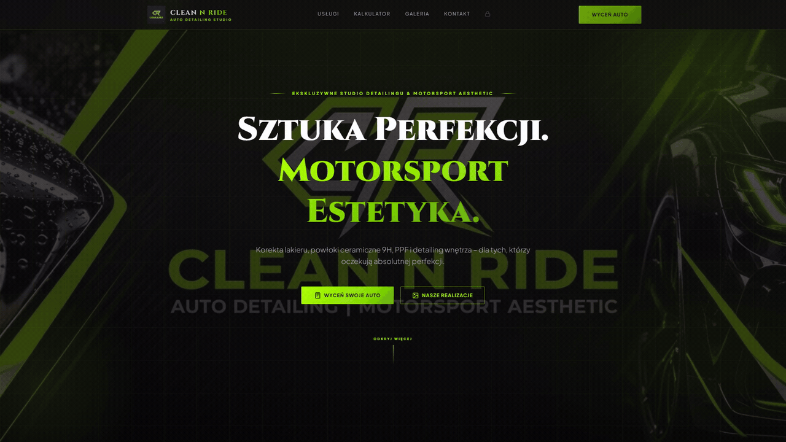
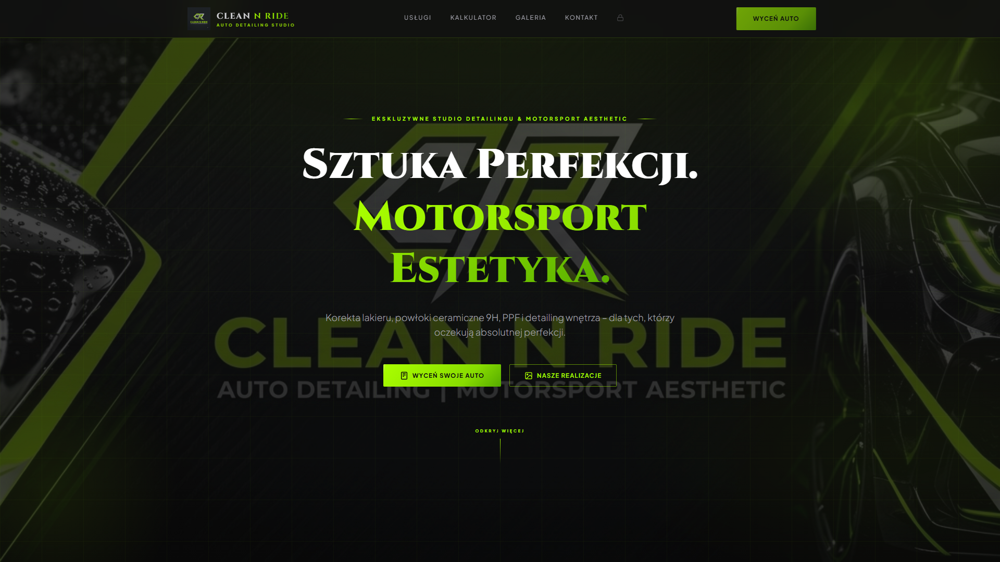
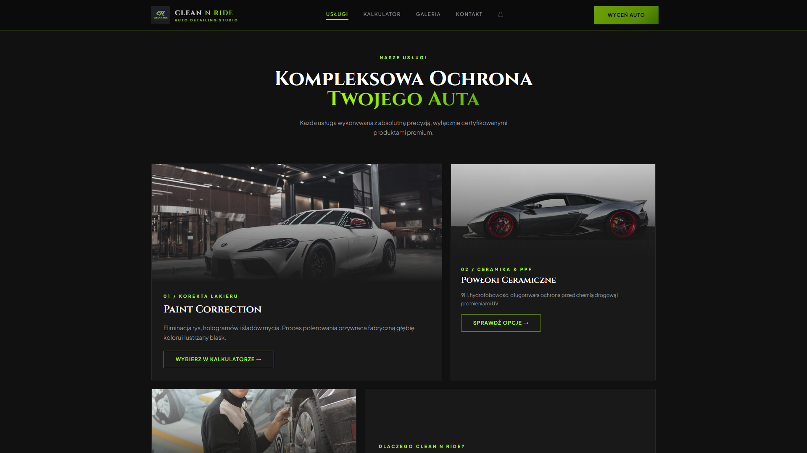
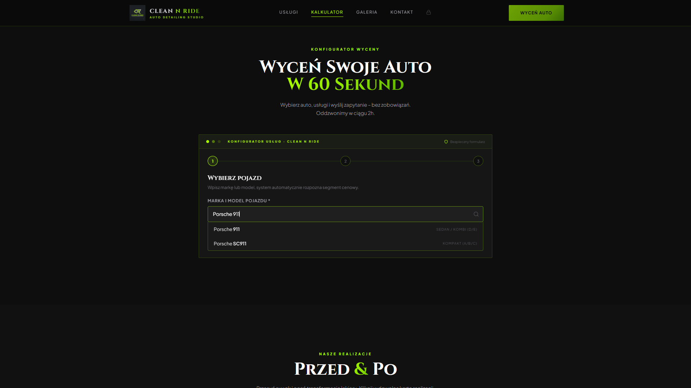
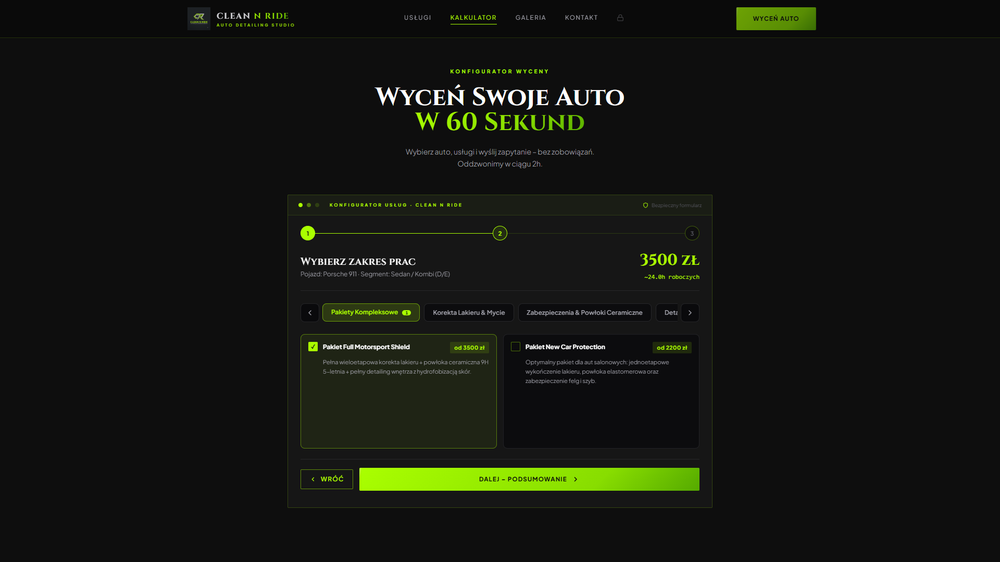
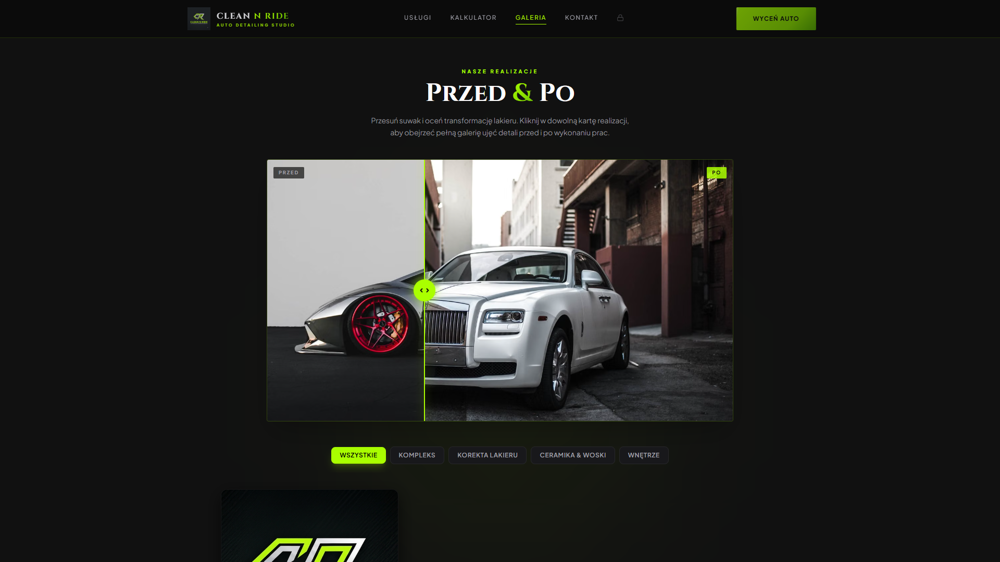
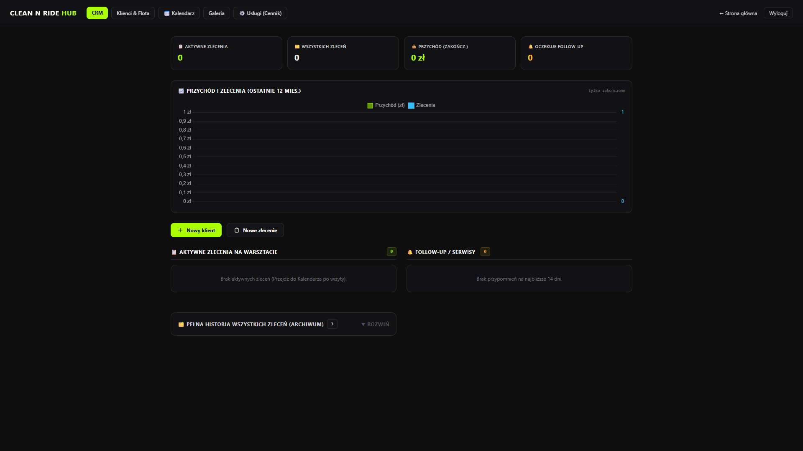
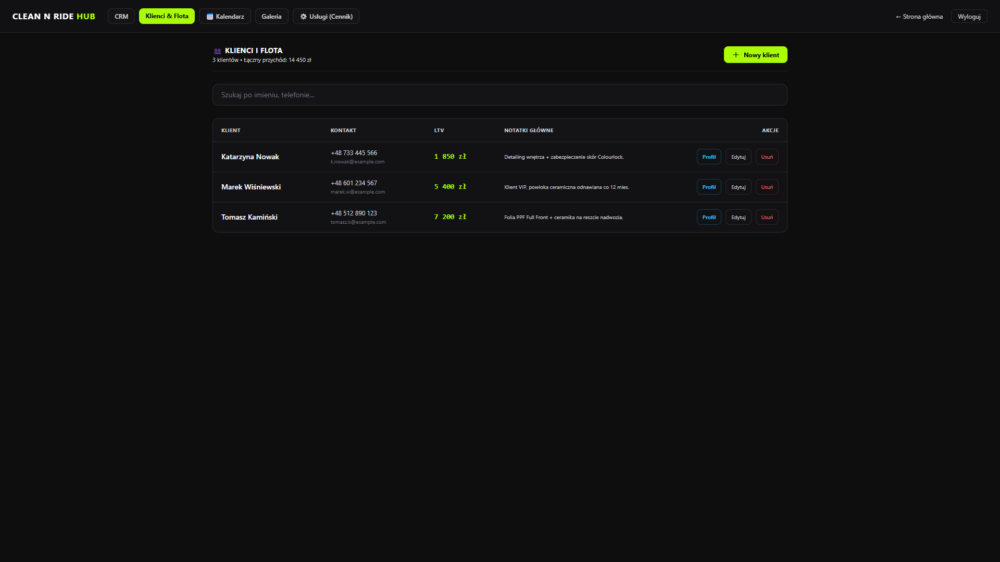
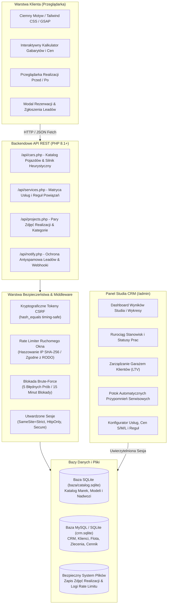

<div align="center">

# Clean N Ride

### Platforma Webowa dla Studia Auto Detailingu & Dedykowany System CRM

[](https://www.php.net/)
[](https://www.mysql.com/)
[](https://www.sqlite.org/)
[](https://developer.mozilla.org/en-US/docs/Web/JavaScript)
[](https://tailwindcss.com/)
[](https://greensock.com/gsap/)
[](admin/login.php)
[](LICENSE)

<br/>

**[🇬🇧 Switch to English Version (README.md)](README.md)**

<br/><br/>

<div align="center">
  
  <p><em>Pełen przepływ studia detailingu: Estetyka Motorsport Hero ➔ Kalkulator Gabarytów i Cen w Czasie Rzeczywistym ➔ Interaktywny Porównywarka Przed / Po ➔ Panel CRM Studia & Baza Floty Klientów</em></p>
</div>

</div>

> [!NOTE]
> ### 🛡️ Showcase Projektu & Specyfikacja Techniczna
> Niniejsze repozytorium pełni rolę **publicznego showcase'u architektonicznego i portfolio**, zawierając opisy architektoniczne, schematy baz danych, interaktywne zrzuty ekranu, konfigurację oraz standardy inżynieryjne.
> Pełny komercyjny kod źródłowy projektu jest dostępny do wglądu dla rekruterów na życzenie (patrz sekcja poniżej).

---

## 📦 O Projekcie

**Clean N Ride** to pełnozakresowa (full-stack) komercyjna platforma internetowa wraz z dedykowanym systemem CRM, opracowana dla ekskluzywnego studia auto detailingu oraz motorsport aesthetics.

Branża detailingu pojazdów mierzy się z dwoma kluczowymi wąskimi gardłami:
1. **Przejrzystość wyceny dla klienta**: Różne gabaryty aut oraz stan powłoki lakierniczej uniemożliwiają sztywne cenniki bez czasochłonnych konsultacji. Clean N Ride rozwiązuje ten problem za pomocą dynamicznego kalkulatora wyceny on-line, integrującego bazę pojazdów z silnikiem heurystycznym kategoryzacji gabarytów.
2. **Operacyjna organizacja pracy studia**: Warsztaty detailingu tracą czas na manualne śledzenie garaży klientów, terminów gwarancji i cykli przeglądów (np. 6-miesięczny przegląd ceramiki, odświeżenie wosku). Clean N Ride dostarcza lekki, błyskawiczny CRM z automatycznym potokiem przypomnień i analityką Customer Lifetime Value (LTV).

Aplikacja powstała bez narzutu ciężkich frameworków, gwarantując czasy odpowiedzi serwera poniżej 50 ms, wysokie bezpieczeństwo defensywne, pełną zgodność z RODO oraz płynne animacje UX oparte na GSAP.

---

## 📸 Prezentacja Rzeczywistego Interfejsu (Real UI Showcase)

### 1. 🏎️ Motorsport Aesthetic Hero & Branding Studia
Mocny, kontrastowy ciemny motyw z akcentami neon lime oraz typografią motorsportową. W pełni responsywny layout, mikro-animacje GSAP ScrollTrigger oraz szybkie wezwania do działania (CTA).

<div align="center">
  
  <p><em>Rzeczywista strona główna: Nowoczesny branding, zwiastuny pakietów i bezpośrednie przejście do kalkulatora wyceny.</em></p>
</div>

<br/>

### 2. 💎 Katalog Usług i Pakietów Detailingowych
Przejrzysta kategoryzacja usług studia (Korekta lakieru One-Step/Two-Step, Powłoki ceramiczne 9H, Folie ochronne PPF, Detailing wnętrza Swissvax). Każda karta prezentuje cenę bazową, szacowany czas roboczy oraz korzyści ochronne.

<div align="center">
  
  <p><em>Katalog Usług: Przejrzyste progi cenowe, gwarancja do 5 lat oraz natychmiastowe dodawanie do kalkulatora.</em></p>
</div>

<br/>

### 3. 🔍 Krok 1: Wyszukiwarka Aut & Heurystyczna Klasyfikacja Gabarytów
Klient wpisuje dokładny model swojego pojazdu (Marka, Model, Generacja, Typ nadwozia). Wyszukiwarka łączy się asynchronicznie z bazą katalogową aut, a wbudowany silnik heurystyczny automatycznie klasyfikuje pojazd do odpowiedniego segmentu gabarytowego (`Segment S`, `Segment M`, `Segment L / SUV`).

<div align="center">
  
  <p><em>Krok 1 Konfiguratora: Autouzupełnianie na żywo dla Porsche 911 (992) Coupe, automatycznie zakwalifikowanego do Segmentu S.</em></p>
</div>

<br/>

### 4. ⚡ Krok 2: Dynamiczny Kalkulator Wyceny & Matryca Reguł
Wybór usług dynamicznie przelicza mnożniki cenowe oraz szacowane roboczogodziny studia. System pilnuje reguł powiązań (np. nałożenie ceramiki wymaga uprzedniej korekty lakieru) i generuje przejrzyste podsumowanie kosztorysu.

<div align="center">
  
  <p><em>Krok 2 Konfiguratora: Aktywny kosztorys na kwotę 3500 ZŁ, szacowane ~24.0h prac dla dwuetapowej korekty i powłoki ceramicznej 9H.</em></p>
</div>

<br/>

### 5. 🪞 Krok 3: Interaktywny Suwak Porównania Przed / Po (Before & After)
Klienci mogą ocenić jakość prac dzięki interaktywnemu sliderowi porównującemu stan lakieru przed i po korekcie (obsługa myszy, dotyku, filtrowanie kategorii: Korekta, Ceramika, Wnętrze).

<div align="center">
  
  <p><em>Porównywarka Przed / Po: Precyzyjna inspekcja usunięcia rys i głębi lakieru na czarnym lakierze metalizowanym.</em></p>
</div>

<br/>

### 6. 📊 Dashboard CRM Studia & Rurociąg Zleceń
Centrum zarządzania studiem detailingu: miesięczne wskaźniki przychodu, aktywne zlecenia w procesie (`pending` ➔ `in_progress` ➔ `ready` ➔ `completed`), pozyskiwanie nowych klientów oraz wykresy obrotów.

<div align="center">
  
  <p><em>Panel CRM: Kluczowe metryki biznesowe, statusy stanowisk detailingu, lista zleceń i szybkie przejście do bazy klientów.</em></p>
</div>

<br/>

### 7. 🚘 Baza Klientów i Garaż Floty (LTV)
Zarządzanie relacjami z klientami: profile klientów, powiązane garaże aut (np. Porsche 911 GT3 RS, BMW M3 CS), wskaźnik Customer Lifetime Value (LTV), historia wizyt oraz notatki techniczne.

<div align="center">
  
  <p><em>Zarządzanie Flotą: Profile z numerami rejestracyjnymi, VIN, etykietami całkowitego obrotu (14 450 zł LTV) oraz historią zleceń.</em></p>
</div>

---

## 🏗️ Architektura Systemu



---

## 🧠 Najważniejsze Rozwiązania Inżynieryjne

### 1. Silnik Heurystyczny Segmentacji Aut (`api/cars.php`)
Bazy urzędowe i producenckie często zawierają błędy klasyfikacji (np. zakwalifikowanie luksusowego SUV-a jako kombi). Silnik heurystyczny normalizuje nazwy modeli i wymusza właściwe segmenty detailingu:

```php
function getModelBaseSegment(string $brand, string $model): ?int {
    $full = strtolower(trim($brand . ' ' . $model));

    // Wymuszenie Segmentu L dla dużych SUV-ów i pickupów
    if (preg_match('/\b(x5|x6|x7|q7|q8|gle|gls|cayenne|range rover|touareg|f-150|ram|urus|dbx)\b/i', $full)) {
        return 2; // Segment L (SUV / Van / Limuzyna)
    }
    // Wymuszenie Segmentu S dla aut miejskich i kompaktowych coupe
    if (preg_match('/\b(fiat 500|yaris|corsa|clio|i10|i20|up!|aygo|smart|mini)\b/i', $full)) {
        return 0; // Segment S (Małe)
    }
    return null; // Fallback do bazy typów nadwozia (Sedan/Touring -> Segment M)
}
```

### 2. Ochrona Prywatności w Rate Limiterze (`api/notify.php`)
Zgodnie z wymogami RODO/GDPR adresy IP nie mogą być trwale zapisywane na dysku w postaci jawnej. System haszuje IP algorytmem SHA-256 przed zapisem w plikach kontroli ruchomego okna:

```php
// Bezpieczny rate limiter bez jawnych adresów IP na dysku (RODO / GDPR)
$clientIp      = $_SERVER['REMOTE_ADDR'] ?? '0.0.0.0';
$hashedIp      = hash('sha256', $clientIp);
$rateLimitFile = $rateLimitDir . $hashedIp . '.json';

$now = time();
$history = file_exists($rateLimitFile) ? json_decode(file_get_contents($rateLimitFile), true) : [];
$history = array_filter($history, fn($ts) => ($now - $ts) < 300); // Ruchome okno 5 minut

if (count($history) >= 5) {
    http_response_code(429);
    echo json_encode(['error' => 'Zbyt wiele zapytań. Odczekaj chwilę przed ponowną próbą.']);
    exit;
}
```

### 3. Matryca Zależności Usług (Dependency & Rule Engine)
Kalkulator respektuje reguły powiązań technologicznych zdefiniowane w bazie:
- `rules_requires`: Wymogi bezwzględne (np. nałożenie *Powłoki ceramicznej 9H* wymaga wykonania przynajmniej *Jednoetapowej korekty lakieru*).
- `rules_excludes`: Usługi wykluczające się wzajemnie (np. *Korekta lakieru One-Step* wyklucza *Korektę Two-Step*).
- `rules_requires_or`: Wymogi alternatywne (np. usługa wymaga pakietu A LUB pakietu B).

### 4. Zautomatyzowany Cykl Przypomnień Serwisowych
Trwałość detailingu zależy od regularnych inspekcji. Przy zakończeniu zlecenia CRM automatycznie kalkuluje terminy kolejnych wizyt:
- **6 i 12 miesięcy**: Przegląd powłoki ceramicznej i dekontaminacja chemiczna
- **3 i 4 miesiące**: Odświeżenie zabezpieczenia woskowego
- **6 miesięcy**: Odżywienie i impregnacja skóry Swissvax
- **6 miesięcy**: Aplikacja niewidzialnej wycieraczki
- **12 miesięcy**: Antybakteryjny detox wnętrza

---

## 🗄️ Architektura Bazy Danych

1. **Katalog Pojazdów (`baza/catalog.sqlite`)**: Szybka, osadzona baza SQLite (~386 KB) z bazą marek, modeli, generacji i nadwozi.
2. **Baza CRM i Aplikacji (`MySQL` z fallbackiem SQLite `baza/crm.sqlite`)**:
   - `services`: Usługi detailingu, wyceny S/M/L, szacowany czas i reguły.
   - `categories`: Grupy usług studia.
   - `customers`: Karty klientów, dane kontaktowe, notatki, łączny obrót.
   - `customer_cars`: Garaż aut klientów (numery rejestracyjne, VIN, rocznik, kolor, segment).
   - `orders`: Zlecenia, przypisane auta, kosztorysy, statusy etapów prac.
   - `projects`: Realizacje Przed/Po z przypisanymi parami zdjęć i kategoriami.
   - `users`: Użytkownicy systemu CRM z hasłami bcrypt i uprawnieniami.

---

## 🚀 Szybki Start & Uruchomienie Lokalne

### Wymagania Systemowe
- **PHP 8.1** lub wyższy (z aktywnymi rozszerzeniami `pdo_sqlite` oraz `pdo_mysql`)
- **Serwer WWW** (wbudowany serwer PHP, Apache lub Nginx)
- **MySQL 8.0+** (opcjonalnie; wbudowany fallback SQLite `crm.sqlite` działa w pełni samodzielnie)

### 1. Klonowanie Repozytorium Showcase
```bash
git clone https://github.com/verblo/clean-n-ride-showcase.git
cd clean-n-ride-showcase
```

### 2. Konfiguracja Środowiska (Opcjonalnie)
Dostępny jest przykładowy plik konfiguracyjny:
```bash
cp config.example.php config.local.php
```

W przypadku łączenia z serwerem MySQL podaj dane dostępowe:
```php
define('DB_HOST',    'localhost');
define('DB_NAME',    'cleannride_crm');
define('DB_USER',    'root');
define('DB_PASS',    'twoje_bezpieczne_haslo');
define('DB_CHARSET', 'utf8mb4');
```
*Uwaga: W przypadku braku bazy MySQL platforma automatycznie przełącza się na lokalną bazę SQLite (`baza/crm.sqlite`).*

### 3. Uruchomienie Serwera Developerskiego
```bash
php -d extension=pdo_sqlite -d extension=sqlite3 -S 127.0.0.1:8000
```

### 4. Dostęp do Platformy
- **Strona Główna & Kalkulator Klienta**: [http://127.0.0.1:8000](http://127.0.0.1:8000)
- **Panel CRM Studia**: [http://127.0.0.1:8000/admin](http://127.0.0.1:8000/admin)
  - **Login**: `admin`
  - **Hasło**: `admin123`

---

## 📄 Licencja

Projekt objęty jest licencją [MIT License](LICENSE).

---

## 💥 Informacja dla Rekruterów / Recruiter Notice

> **Pełny kod źródłowy projekt dostępny do wglądu dla rekruterów na życzenie po kontakcie mailowym.**
> 
> Kompletny komercyjny kod źródłowy, pełna historia commitów oraz dokumentacja wdrożeniowa są dostępne dla rekruterów i zespołów technicznych po bezpośrednim kontakcie:
> - 📬 **E-mail**: [dominikzatorski8@gmail.com](mailto:dominikzatorski8@gmail.com)
> - 💼 **LinkedIn**: [Dominik Zatorski](https://pl.linkedin.com/in/dominik-zatorski-b1a82a1b9)
> - 🐙 **Profil GitHub**: [@verblo](https://github.com/verblo)

---

## 👤 Autor

**Dominik Zatorski**
- Portfolio / GitHub: [@verblo](https://github.com/verblo)
- LinkedIn: [Dominik Zatorski](https://pl.linkedin.com/in/dominik-zatorski-b1a82a1b9)
- Email: [dominikzatorski8@gmail.com](mailto:dominikzatorski8@gmail.com)
